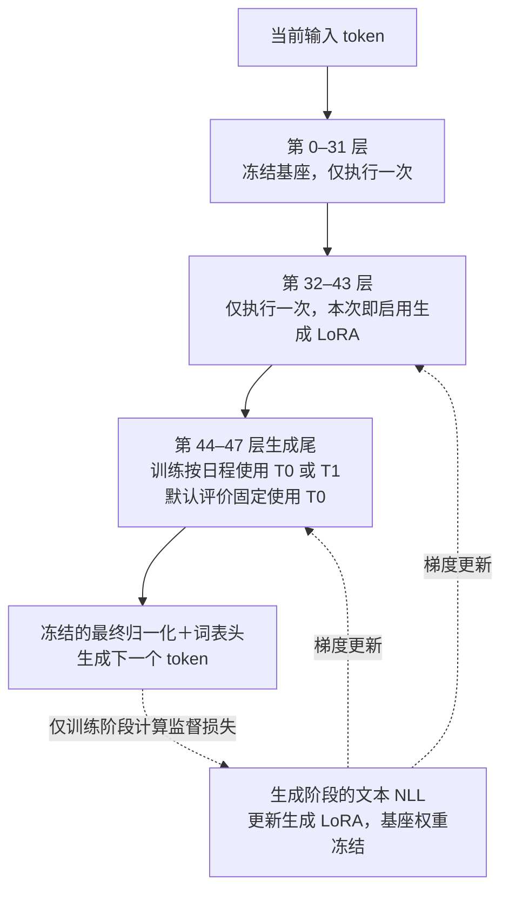
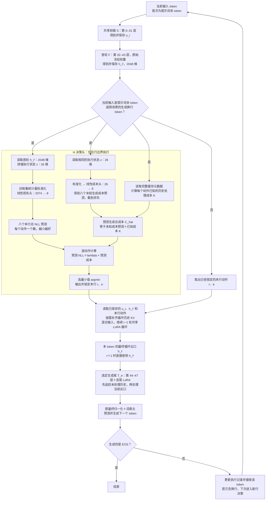
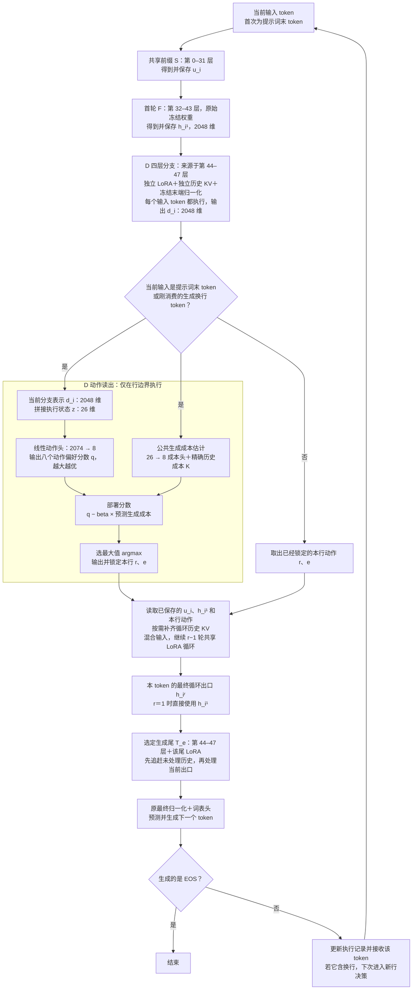
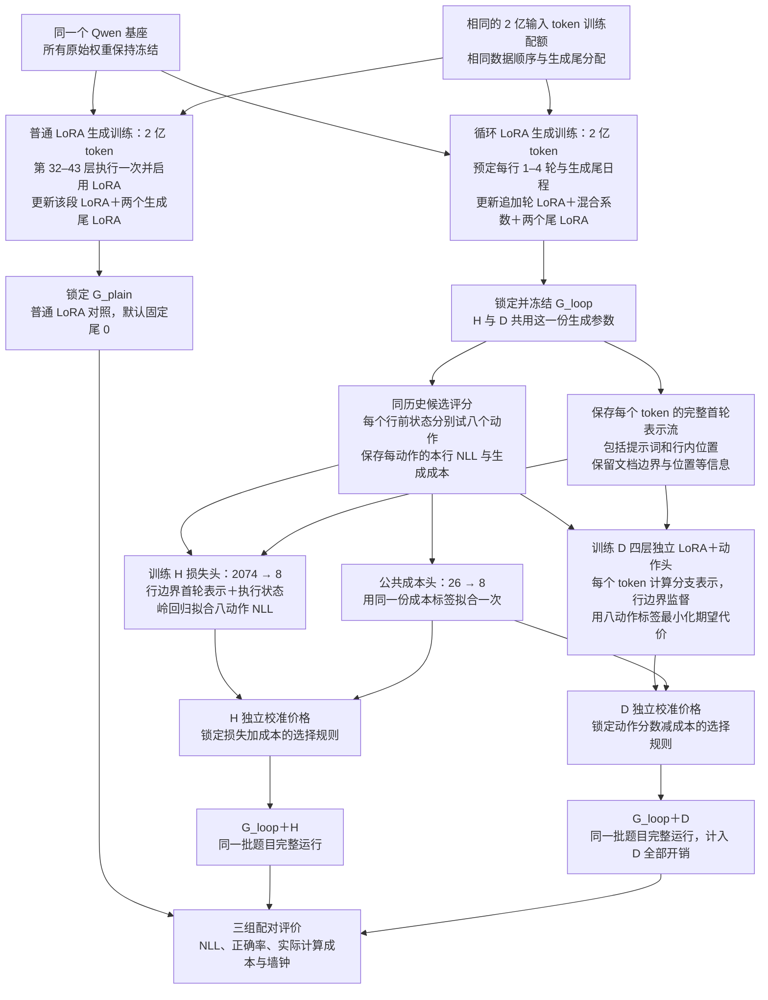

# v4 生成 LoRA、H 与 D 架构及训练对比

本图比较三组实验：普通 LoRA 对照、循环 LoRA＋H、循环 LoRA＋D。低秩适配（Low-Rank Adaptation，LoRA）用于训练生成能力；H、D 用于选择每行的循环次数和生成尾。D 分支自身也配置一套独立 LoRA。

H、D 两组共用同一次生成训练得到的检查点：第 0–31 层共享前缀、第 32–43 层循环段、第 44–47 层生成尾。H 直接给已有表示打分；D 先增加四层表示计算，再读出动作分数。普通 LoRA 对照单独训练，用于衡量加入循环与控制后的整体效果。

H、D 均画双尾八动作版本。动作 $(r,e)$ 中，$r\in\{1,2,3,4\}$ 是总循环次数，$e\in\{0,1\}$ 是生成尾编号。八个输出依次对应：

| 输出位置 | 0 | 1 | 2 | 3 | 4 | 5 | 6 | 7 |
|---|---|---|---|---|---|---|---|---|
| 动作 | 1 轮＋尾 0 | 1 轮＋尾 1 | 2 轮＋尾 0 | 2 轮＋尾 1 | 3 轮＋尾 0 | 3 轮＋尾 1 | 4 轮＋尾 0 | 4 轮＋尾 1 |

输出位置编号为 $2(r-1)+e$。并列时选较小编号。固定尾 0 的四动作实验只保留对应的四个选择，并重新拟合四输出读出。

## 1. 普通 LoRA 对照架构

普通 LoRA 对照记为 $G_{\rm plain}$。它沿原模型顺序执行一次，在第 32–43 层和两个第 44–47 层生成尾配置 LoRA。生成训练中两个尾按与循环模型相同的日程分配，以文本负对数似然（Negative Log-Likelihood，NLL）为监督损失；默认评价固定使用尾 0。

该组每个 token 的主路径为 48 层，生成适配参数共 351,600,640 个。循环模型的首轮第 32–43 层使用原始冻结权重，追加轮才使用 LoRA；普通 LoRA 对照在唯一一次第 32–43 层前向就启用 LoRA。因此，将循环模型固定为一轮，得到的执行路径仍与普通 LoRA 对照有区别。

## 2. 循环 LoRA＋H 打分器架构

首轮出口已经是结合上下文计算出的 2048 维表示。H 将它与 26 维执行状态拼在一起，预测八种动作各自的本行损失。另一个小线性头预测成本；最终由“预测损失＋成本惩罚”选出动作。

图从提示词末位开始，随后每个生成 token 都按同一流程处理。提示词前部的预填充见第 4 节。生成阶段训练循环 LoRA、混合系数与两个尾的 LoRA；H 拟合阶段将这些生成参数全部冻结。

### H 决策头实际计算什么

H 的损失头是一个带偏置的线性模型，岭回归用于训练它的系数：

$$
\widehat{\boldsymbol\ell}
=W_H\,\operatorname{std}([z_c;h_{b_c}^{(1)}])+b_H,
\qquad
W_H\in\mathbb R^{8\times2074}.
$$

其中 $\operatorname{std}$ 使用拟合集保存的均值与标准差。八个输出的含义是八个动作对应的本行总负对数似然（Negative Log-Likelihood，NLL）预测。这个头共有 $8\times2074+8=16{,}600$ 个系数。

公共成本头只读取 26 维状态：

$$
\widehat{\boldsymbol U}
=\max\!\left(0,W_C\operatorname{std}(z_c)+b_C\right),
\qquad
W_C\in\mathbb R^{8\times26}.
$$

它有 $8\times26+8=216$ 个系数。已知的历史补写与尾追赶成本从完整缓存元数据精确计算，得到八维向量 $\boldsymbol K(s_c)$。于是

$$
\widehat{\boldsymbol C}
=\boldsymbol K(s_c)+\widehat{\boldsymbol U},
\qquad
a_c=\arg\min_a\left[\widehat\ell_a+\lambda\widehat C_a\right].
$$

$\lambda$ 决定对计算成本的重视程度，在校准集上选择。损失头、成本头和选最小值的规则共同构成这里的 H 决策模块。它最终输出两个整数 $(r,e)$；文本 token 由下游生成尾和词表头输出。

26 维执行状态包括行号、上一行长度、当前位置、上一行动作、历史实际循环覆盖、缺失缓存数量，以及两个尾分别积压多少历史。未来这一行的长度不属于输入。

R 对照沿用同一个成本头与选择规则，把损失头的输入改为仅 26 维状态。R 与 H 分别运行，用来测量增加首轮表示的收益。

### H 如何训练

先完成生成器的 2 亿 token 训练，再冻结生成参数。对同一个行前状态，分别试八个动作，在同一参考行上记录八个总 NLL 和实际生成成本。损失头拟合八个 NLL；成本头拟合实际生成成本扣除已知历史成本后的剩余部分。

同一文档的全部行与历史轨迹放入同一交叉验证折。训练标签使用参考答案，部署决策只使用已消费前缀。H 拟合时，生成器保持冻结。

## 3. 循环 LoRA＋四层 D 决策分支架构

D 在首轮出口后增加一条独立四层分支。这四层对每个输入 token 都运行，利用自己的历史键值缓存处理完整首轮出口流。到行边界时，才把当前分支表示交给动作头。

四层分支负责计算表示；真正输出八个动作分数的是末端的线性动作头。两者共同构成 D 决策模块。

### D 决策头实际计算什么

首先，四层分支读取首轮出口流，使用自己的历史缓存生成当前表示：

$$
d_i=D_\psi\!\left(\operatorname{sg}(h_{\le i}^{(1)})\right)
\in\mathbb R^{2048}.
$$

$\operatorname{sg}$ 表示停止向生成器传播梯度。$D_\psi$ 包含四层分支及其冻结末端归一化。当前位置的分支表示与同一组 26 维状态拼接后，由线性动作头输出八个分数：

$$
q_c=W_D[z_c;d_{b_c}]+b_D,
\qquad
W_D\in\mathbb R^{8\times2074}.
$$

这个动作头同样只有 16,600 个参数。额外容量主要来自前面的四层分支：四层 LoRA 共有 70,320,128 个参数，加上动作头为 70,336,728 个。

$q_c$ 表示动作偏好，其数值不是某个动作的 NLL 预测。部署时选择

$$
a_c=\arg\max_a\left[q_c(a)-\beta\widehat C_c(a)\right].
$$

$\widehat C_c$ 沿用 H/R 的公共生成成本估计。$\beta=0$ 时按动作分数直接选择；$\beta>0$ 时加入生成成本惩罚。$\beta$ 在校准集上选择。D 自身每个 token 的四层计算及动作读出另入完整成本账本，比较预算时全部计费。

D 的表示用于选动作。追加循环继续从已经保存的 $u_i,h_i^{(1)}$ 开始，最终循环出口进入所选生成尾；D 的出口没有接到生成词表头。

### D 如何训练

先训练并冻结同一个生成器，再训练 D 的 LoRA 和动作头。对同历史候选表，训练时将八个分数变成概率：

$$
\pi_c(a)=\operatorname{softmax}(q_c)_a.
$$

固定训练价格 $\lambda_D$，最小化候选代价的加权平均：

$$
L_D
=\sum_c\sum_a
\pi_c(a)\,
\operatorname{sg}\!\left[\ell_c(a)+\lambda_D C_c(a)\right].
$$

该目标推动概率转向本行损失与成本较低的动作。softmax 在这里用于构造训练目标，部署按前述分数取最大值。

这里 $C_c(a)$ 记录候选动作的生成成本。同历史、同参考行的教师强制评价中，D 处理的首轮出口流与 token 数相同，因此该行 D 自身的计算成本对八个动作相同。把这项共同成本加入目标，只会增加一个与动作概率无关的常数；完整轨迹评价仍计入这项成本。

$\lambda_D$ 是训练代价中的价格，$\beta$ 是部署分数中的成本惩罚系数。它们的用途和分数尺度不同，分别校准和记录。生成器冻结，D 内部的历史表示仍参与反向传播。

## 4. 首行与后续行的决策时刻

H、D 两张图中的循环次数 $r$ 都包含已经完成的首轮。选 3 轮时，决策之后再执行 2 轮。

| 时刻 | H 版 | D 版 |
|---|---|---|
| 提示词前部 | 计算共享前缀和首轮，保存历史出口 | 同样计算，并逐 token 更新 D 的历史 |
| 提示词末 token | 首轮完成后调用 H，选择第一行动作 | 首轮和 D 完成后调用动作头，选择第一行动作 |
| 同一行中间 | 每 token 正常生成，沿用本行动作 | 每 token 正常生成并更新 D，沿用本行动作 |
| 已生成换行 token，并将它作为当前输入消费 | 重新调用 H，决定下一行 | 更新 D 后读取动作头，决定下一行 |
| 生成 EOS | 结束生成 | 结束生成 |

提示词前部不运行生成尾或词表头。第一行动作确定后，选中的尾先处理积压的提示词出口，再处理当前位置，产生第一枚输出 token。初次决策时，上一行动作使用缺失标记，缓存进度取实际值。

两版都遵守“先决定本行动作，再生成本行首 token”。动作在整行内固定；生成的换行 token 属于上一行，消费该 token 后才决定下一行。

## 5. 三组实验的对比

| 项目 | 普通 LoRA 对照 | 循环 LoRA＋H | 循环 LoRA＋D |
|---|---|---|---|
| 生成检查点 | 单独训练的 $G_{\rm plain}$ | 共用 $G_{\rm loop}$ | 与 H 共用同一个 $G_{\rm loop}$ |
| 第 32–43 层 | 执行一次，启用 LoRA | 首轮原权重，追加轮共用 LoRA | 与 H 相同 |
| 总循环次数 | 固定一次 | 每行选择 1–4 次 | 每行选择 1–4 次 |
| 生成尾 | 两尾均训练，默认评价固定尾 0 | 每行选择尾 0 或尾 1 | 每行选择尾 0 或尾 1 |
| 生成侧适配与混合参数 | 351,600,640 | 351,602,688 | 同一份 351,602,688 |
| 生成阶段输入量 | 2 亿 token | H、D 合计共用一次 2 亿 token | 同左 |
| 控制器训练 | 无行级控制器 | 拟合 H 损失头，共用成本头 | 训练 D-LoRA 和动作头，共用成本头 |
| 控制器训练时的生成参数 | 已完成生成训练 | 全部冻结 | 全部冻结 |
| 决策附加参数 | 0 | H 头 16,600＋成本头 216 | D-LoRA 与动作头 70,336,728＋成本头 216 |
| 生成位置的当前主路径层数 | 48 | $36+12r$，即 48–84 | $40+12r$，即 52–88 |
| 对比用途 | 生成质量参考 | 测量低成本按行控制的效果 | 测量增加决策计算后的完整控制器效果 |

层数只统计当前位置的完整层调用；实际费用另计历史 KV 补写、生成尾追赶、LoRA、词表头与读出。H、D 使用同一个成本头，联合开展实验时只拟合一次。表中各部署方案列出它所需的参数，实验总数按共享关系去重。

普通 LoRA 默认固定尾 0，双尾 H、D 可以切换生成尾。三组比较同时涉及循环执行与尾选择；固定尾 0 的四动作 H 与同一生成器的固定或均匀深度对照比较，用于检查循环调度的贡献。H 与 D 的比较保持生成器相同，但同时改变决策表示计算与拟合目标。

### H 与 D 决策头的直接对比

| 项目 | H 版 | 四层 D 版 |
|---|---|---|
| 决策表示 | 直接取已有首轮出口 | 首轮出口再经过四层独立处理 |
| 末端头输入 | 2048 维首轮表示＋26 维状态 | 2048 维 D 表示＋26 维状态 |
| 末端头输出 | 八个本行总 NLL 预测 | 八个动作偏好分数 |
| 动作选择 | 损失加成本，取最小值 | 分数减成本，取最大值 |
| 主要训练方式 | 岭回归拟合损失与成本标签 | 训练 D-LoRA 与动作头的期望代价目标 |
| 决策额外计算频率 | 仅行边界的轻量读出 | 每 token 四层计算，行边界再读出 |
| 生成尾与词表头 | 由所选生成尾产生文本 | 同左，D 保持独立决策职责 |

两个生成尾与 D 都来源于第 44–47 层，共享只读基座权重；各自的 LoRA 和 KV 缓存独立。H 版只使用两个生成尾。D 版增加第三套用途为决策的分支。

## 6. LoRA、H、D 的完整训练流程

当前方案采用分阶段训练：先训练生成能力，再在冻结生成器上训练控制器。下面两条生成训练臂各执行一次；H、D 从同一个循环生成检查点分开训练。图中的分叉表示数据与参数依赖，实际调度按同一台八卡节点的资源顺序执行。

生成训练的总输入量为

$$
N_{\rm gen}
=N_{G_{\rm plain}}+N_{G_{\rm loop}}
=2\times10^8+2\times10^8
=4\times10^8.
$$

H、D 训练与候选枚举的输入量另计。保留普通 LoRA 对照时，生成训练共两臂；H、D 共享其中的循环臂，费用只计算一次。

缓存的是冻结首轮出口。D 每次训练仍重新计算自己的四层表示和 KV，梯度沿 D 的历史计算传播。只保存行边界的首轮向量，无法恢复 D 对全部前缀的注意力计算。H 使用其中的行边界向量，D 使用完整序列。

第一轮只增加双尾八动作 D 对照，复用八动作 H 的 100 万原始目标 token 控制集。四动作 H/R 仍按一天版方案保留；四动作 D 可作为后续扩展。

## 7. 三部分训练的时间口径

以下是条件计算示例。生成侧 LoRA 的 2 亿 token 指累计非填充输入量；D 的输入量包含提示词与完整历史。实际吞吐由八卡 H200 上的短跑确定。

假设循环生成 LoRA 的八卡合计有效吞吐为 10,000 输入 token/s，普通 LoRA 为 16,000 输入 token/s。再假设八动作 D 控制集每遍实际处理 400 万输入 token，训练 3 遍，D 吞吐为 10,000 输入 token/s，则

$$
\begin{aligned}
T_{G_{\rm loop}}
&=\frac{200{,}000{,}000}{10{,}000\times3600}
\approx5.56\text{ 小时},\\
T_{G_{\rm plain}}
&=\frac{200{,}000{,}000}{16{,}000\times3600}
\approx3.47\text{ 小时},\\
T_D
&=\frac{4{,}000{,}000\times3}{10{,}000\times60}
=20\text{ 分钟}.
\end{aligned}
$$

| 项目 | 循环 LoRA＋H | 循环 LoRA＋D | H、D 都训练时如何计费 |
|---|---|---|---|
| 循环生成 LoRA | 2 亿输入 token；示例 5.56 小时 | 使用同一个生成检查点 | 共计一次 5.56 小时 |
| 八动作候选标签 | 拟合 H 所需 | 复用同一组标签 | 生成一次，按实际历史处理量计时 |
| H 与公共成本头 | 拟合小型线性模型 | 复用公共成本头 | H 拟合与成本头拟合各计一次 |
| D 分支训练 | 无 | 示例 1200 万累计输入 token；20 分钟 | 新增这 20 分钟 |
| 首轮表示缓存 | H 只使用行边界向量 | D 使用完整 token 序列 | 完整序列保存与读取单列 |
| 预算校准与评价 | 独立执行 H | 独立执行 D | 两者都计入，轨迹与缓存状态各自推进 |
| 普通 LoRA 对照 | 两组共用同一对照 | 两组共用同一对照 | 额外一次 2 亿 token；示例 3.47 小时 |

在这些吞吐假设下，循环 LoRA 与 D 的纯训练计算合计约 5.89 小时，再加 H 与公共成本头的实际拟合时间；加入普通 LoRA 对照后约为 9.36 小时，再加拟合时间。两个范围的训练阶段分别预留约 6–7 小时与 9.5–10.5 小时。

这些时长还需加上候选标签生成、表示缓存、预算校准、评价及正确性核验。相对已有 H 路线，新增 D 可暂留 2–4 小时用于缓存、训练和完整对照；该预留只适用于上述小型控制集与单次 D 训练。若 D 自身改为累计处理 2 亿输入 token，按同一 10,000 token/s 假设，仅 D 训练就需约 5.56 小时。

本流程对应生成器冻结后的控制器训练。生成 LoRA、H、D 同步更新会改变候选损失标签，需另行定义标签更新和联合训练成本。24 小时目标以所有阶段的实测总时长判断。

架构定义见[架构正文](ARCHITECTURE.v4.zh-CN.md)，数学边界见[数学附录](ARCHITECTURE_MATH.v4.zh-CN.md)，每臂 2 亿 token 的安排见[一天版实验方案](EXPERIMENT_PLAN.v4-one-day.zh-CN.md)。
